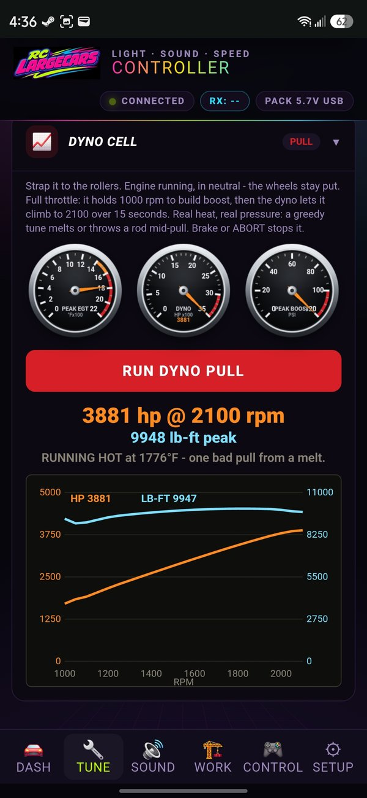

# RCLC D15 Engine Simulator

> 🤖 **Vibe coded.** Every line of this firmware, the web flasher, the phone
> control panel and the Sound Studio was built by vibe coding with AI
> (Anthropic's Claude), driven by one RC trucker with a soldering iron and a
> very particular ear. Built for fun, tuned by ear, tested on a real truck.

### ⚡ [Flash it in your browser — no software to install](https://turbotike.github.io/d15-engine-simulator-/)
### 🎧 [Sound Studio — build your own engine pack](https://turbotike.github.io/d15-engine-simulator-/studio.html)
### 🛠 [Order the board](#ordering-the-board) · 🧭 [Add the gyro](#the-gyro-gy-521--mpu-6050)

The **RCLC D15** turns an RC semi into a running diesel. It's a small
4-layer board with an ESP32-S3 that sits between your receiver and your ESC.
It *simulates the whole truck* in real time: the engine, turbo, gearbox,
clutch, air brakes, jake brake, and the truck's weight. Your throttle stick
talks to the simulated engine, and **the simulation drives the ESC**. The truck
pulls like it weighs 36 tonnes, shifts like a driver is rowing a 10-speed, and
sounds like a recorded Cat C15 because that's what it plays.

Everything is set up from your phone over the truck's own Wi-Fi. No app and
no laptop needed after the first flash.

---

## Contents

- [What it does](#what-it-does)
- [What you need](#what-you-need)
- [Ordering the board](#ordering-the-board)
- [Soldering the board](#soldering-the-board)
- [Wiring the truck](#wiring-the-truck)
- [Flashing the firmware](#flashing-the-firmware)
- [The SD card and sound packs](#the-sd-card-and-sound-packs)
- [First power-up](#first-power-up)
- [The phone control panel](#the-phone-control-panel)
- [The engine, parts and tuning](#the-engine-parts-and-tuning)
- [Tuning guide (no cheat codes)](#tuning-guide-no-cheat-codes)
- [Race mode and the drag strip](#race-mode-and-the-drag-strip)
- [The gyro (GY-521 / MPU-6050)](#the-gyro-gy-521--mpu-6050)
- [Active front suspension](#active-front-suspension)
- [Lights](#lights)
- [Work mode, hydraulics and the dump truck](#work-mode-hydraulics-and-the-dump-truck)
- [Wireless trailer](#wireless-trailer)
- [Battery = fuel](#battery--fuel)
- [Sound Studio: make your own engine](#sound-studio-make-your-own-engine)
- [Building from source](#building-from-source)
- [Bench / serial commands](#bench--serial-commands)
- [Troubleshooting](#troubleshooting)
- [Known limitations](#known-limitations)
- [What's in this repo](#whats-in-this-repo)
- [Credits and license](#credits-and-license)

---

## What it does

### The engine
- **Real recorded Cat C15.** Seven engine loops and five exhaust loops, each
  cut on whole firing cycles and measured for its true rpm, crossfaded and
  pitch-shifted to the simulated rpm, through two on-board 3 W class-D amps.
- **A physics engine underneath, not a sound player.** Fuel and air are modelled
  separately. The turbo spools from real exhaust energy, boost fills the
  cylinders, the intercooler cools the charge, and timing sets efficiency and
  cylinder pressure. Exhaust gas temperature rises and falls with load. Overfuel
  it and it smokes. Run it too hot and it **melts a piston**. Too much boost on
  weak rods and it **throws a rod**.
- **Revs with weight.** Real C15 rotating inertia and friction, and a boost-limited
  fuel rack when free-revving in neutral. A blip takes about a second to climb
  and longer to fall.
- **The full start sequence.** Starter, cranking (it catches when it's ready, not
  on a timer), fire-up and idle. Shutdown runs down, then cooling ticks.
- **Jake brake** that builds with rpm, using real Jacobs horsepower figures. The
  injectors cut out and the engine barks.
- **Turbo whistle, blow-off and spool** follow the turbo shaft speed, not the
  throttle.
- **The lope.** Fit big-plunger injectors and the idle comes alive. Real recorded
  firing pulses are lifted, dropped and fattened one at a time, in a rhythm that
  is never the same twice, with the rpm kicking on every fat shot. On the rev
  limiter those injectors **pop**. A messed-up idle tune gives a random stumble
  instead.

### The truck
- **10-speed transmission** with realistic shift timing. Downshifts have a neutral
  blip and upshifts are spread so they never sound metronomic. It holds gears
  while the jake is on, and you get neutral and reverse with a backup beeper.
- **Clutch** with torque coupling and heat fade.
- **Weight that matters.** Trailer load setting from bobtail to heavy haul, and
  aero and rolling drag. *Full Stop Time* sets how hard full brakes stop it.
- **Air system.** Compressor, air dryer purge, brake application hiss, park brake
  set and release, spring brakes that hold the truck until the air is up, and a
  low-air buzzer.
- **Real hills** with the optional $3 gyro. Ramps load the engine, the box holds
  a lower gear on a climb, and the throttle cuts if the truck rolls over.
- **Active front suspension** with two servos. Body roll in corners, dive and squat,
  torque twist under power, a little bounce, and gauges on your phone.

### Everything else
- **Lights:** headlights, tail and brake, reverse, front and rear indicators,
  hazards, side markers, cab light, beacon and two assignable AUX outputs (high
  beam, fog, roof bar, dedicated brake light, second beacon). Indicators by
  holding the steering, and hazards by a steering gesture.
- **Upgradeable parts:** rods, pistons, turbo, intercooler and injectors, three tiers
  each. **The parts decide the horsepower**: about 600 hp stock, 1500 hp on
  the middle parts and 3000 hp on the top parts.
- **Tuning** in real Cat units: fuel in mm³ per stroke, timing in °BTDC, eight rpm
  bands, a wastegate, and a **dyno cell** that pulls the engine and tells you why it
  failed.
- **Engine health** and a **point-and-click engine rebuild mini-game** on real
  C15 photos. Do it yourself or pay for a pro rebuild.
- **Race mode:** pick a four-gear ladder, stage it, launch with a timed clutch
  release, and get a time slip (60 ft, quarter mile, trap speed).
- **Work mode:** four hydraulic functions on servo headers, a PTO throttle, a dump
  bed, and a pump sound if your pack has one.
- **Wireless trailer** over ESP-NOW: lights and landing legs, using the
  DIYGuy999 trailer protocol.
- **Battery = fuel.** The 2S pack's charge is the fuel gauge. At the cut-off the
  engine starves, sputters and dies like it ran dry, and the truck coasts down.
- **Receivers:** iBUS, SBUS or PWM, auto-detected. Every function can be remapped
  to any channel.
- **CONTROL tab:** turn any free channel header into a servo output.
- **Phone dashboard:** tach, speedo, boost, air, water, oil, pyro (EGT),
  volts, fuel, trans and hydraulics gauges, plus live dyno numbers.

---

## What you need

| Item | Notes |
|---|---|
| **RCLC D15 board** | Assembled by PCBWay, see [Ordering the board](#ordering-the-board) |
| **Freenove ESP32-S3-WROOM Lite, MCN16R8** | The brain. **Must be the MCN16R8** (16 MB flash, 8 MB *octal* PSRAM). It plugs into the U1 socket. |
| **8 through-hole parts** | Pin headers and the module socket, listed in [Soldering the board](#soldering-the-board) |
| **2S LiPo** | 7.4 V. The battery input is **not polarised**, so check + / − every time. |
| **ESC with a BEC** | Any normal car ESC. Its BEC powers the servos and tells the board a pack is in. |
| **Receiver** | iBUS (FlySky), SBUS (FrSky, Radiolink…) or plain PWM |
| **Two speakers** | 4–8 Ω, around 3 W each (or just one - both amps play the full mix) |
| **LEDs** | Wired common +5 V with your own resistors; the board switches the ground side |
| **microSD card** | 4–32 GB, **FAT32**. Cards of 64 GB and up come exFAT and won't mount. |
| **USB-C data cable** | For flashing |
| *Optional:* **GY-521 (MPU-6050)** | Hills, smart shifting, rollover cut, suspension input |
| *Optional:* **I2C splitter** | To run the gyro and future add-ons off one header |
| *Optional:* **2 servos** | Active front suspension |

---

## Ordering the board

> 🚧 **The PCBWay project link goes here once it's live.**

The board is a **4-layer, 57.5 × 77.5 mm** PCB, and the factory assembles all
the surface-mount parts, about 60 placements on the top side only. You solder
8 through-hole parts yourself (next section). The design files (gerbers, parts
list, pick-and-place) live on the PCBWay project page.

### How to order
1. Open the **RCLC D15** project on PCBWay *(link coming)*.
2. Choose **PCB + Assembly** and the quantity (5 boards is the usual minimum).
3. Check the options match the project: **4 layers, 1.6 mm, 5/5 mil track/space**,
   SMD assembly on the **top side only**.
4. Paste the project's **order notes** into the notes box. They cover the parts
   whose rotation must be checked (Q1/Q2, U3, the two amps U4/U9, the regulators
   U7/U8), the PCA9685's centre pad (no paste) and via tenting.
5. Order. PCBWay emails a **placement preview** to approve. Look at those rotations
   before you say yes.

The through-hole parts (the module socket and the pin headers) are left out of
the assembly on purpose. You fit them, so you choose header heights and pin
direction to suit your truck.

Expect a few weeks from order to doorstep, depending on shipping.

---

## Soldering the board

Eight through-hole parts. All are simple pin headers apart from the module
socket. Solder them from the top with the pins pointing down, or up, to suit
your truck.

| Ref | Part | What it's for |
|---|---|---|
| **U1** | Socket for the Freenove ESP32-S3 Lite | The brain plugs in here, so it's removable |
| **BATT1** | 1×2 pin header | 2S pack in: **pin 1 = +, pin 2 = GND. Not polarised!** |
| **J4** | 1×18 header | Channel headers: **GND** row |
| **J5** | 1×18 header | Channel headers: **+5 V** row (from your ESC's BEC) |
| **J6** | 1×18 header | Channel headers: **signal** row |
| **J7** | 1×22 header | Light **+5 V** row, plus SPK1+ and SPK2+ |
| **J8** | 1×22 header | Light **switched** row, plus SPK1− and SPK2− |
| **ACC1** | 1×8 header | Accessory / I2C: the gyro plugs in here |

J4, J5 and J6 together make the familiar three-row servo header block. J7 and
J8 make the light header block, with the speakers at the end.

**Tips**
- Tack one pin of each header first, check it sits square, then do the rest.
- Use a fine tip and good flux. These are 2.54 mm headers, so nothing tricky.
- **Don't solder the ESP32 module directly.** Use the socket, so you can swap it.
- Before the module goes in: meter **BATT1** for no short, and with a pack on,
  check the board's 3.3 V and 5 V rails at **ACC1** (pin 1 = 3V3, pin 2 = 5V,
  pin 3 = GND).
- **Never** power it up by poking loose jumper wires around. Make proper leads.

### ACC1 pinout (accessory header)

| Pin | Signal | Notes |
|---|---|---|
| 1 | **3V3** | For sensors (the gyro) |
| 2 | 5V | |
| 3 | GND | |
| 4 | **SDA** | I2C data (IO10), shared with the light chip |
| 5 | **SCL** | I2C clock (IO11), 400 kHz |
| 6 | IO6 | Spare GPIO |
| 7 | IO7 | Spare GPIO |
| 8 | GND | |

Pin 1 is the **square pad**.

---

## Wiring the truck

```
   2S LiPo ──► ESC ──► motor
     │          │
     │          └─(servo lead)──► board ESC header  (BEC 5 V powers the channel rows)
     └─────────► BATT1 (+/−)  ── the board's own supply + pack-voltage sense

   Receiver ──► RX header (iBUS / SBUS)   or   CH1…CH8 headers (PWM)
   Speakers ──► SPK1, SPK2  at the end of J7/J8
   LEDs     ──► light headers: +5 V row (J7) and switched row (J8)
   Gyro     ──► ACC1  (3V3, GND, SDA, SCL)
```

### Receiver
- **iBUS / SBUS:** one lead into the RX header. Every CH header is then free
  for servos (steering out, suspension, hydraulics…).
- **PWM:** one lead per channel into CH1–CH8. Headers the truck reads can't be
  used as outputs.
- The mode is **auto-detected** at power-up.

**Default channel map** (change any of them under SETUP → RC Channel Map):

| Channel | Function |
|---|---|
| CH1 | Steering |
| CH2 | Throttle: above centre = throttle, below = brake |
| CH4 | Gear (park / forward / reverse) |
| CH5 | Brake |
| CH6 | Engine on/off |
| CH7 | Lights |
| CH8 | Horn |
| CH9 | Jake brake (iBUS/SBUS) |
| CH10 | AUX (iBUS/SBUS) |

### Steering servo
On iBUS/SBUS the board can drive the steering servo itself. Set the header and
endpoints under TUNE → Steering Servo. On PWM, the servo stays plugged into the
receiver.

### Lights
The light outputs **switch the ground side** through ULN2803 drivers. Wire
each LED (with its resistor) from the **+5 V row (J7)** to its **switched pin
(J8)**. The indicators: **J8.3 = left rear, J8.4 = left front, J8.5 = right
rear, J8.6 = right front.** Use TUNE → Light Test to find each output; the full
map is in the schematic on the PCBWay project.

### Speakers
Two MAX98357A class-D amps, **SPK1 (left) and SPK2 (right)**. Both play the full
mix, so one speaker works too. Don't connect either speaker terminal to ground;
class-D outputs are bridged.
Amp gain is 15 dB with R29/R30 fitted; remove them for 9 dB.

---

## Flashing the firmware

### The easy way: in your browser
**[turbotike.github.io/d15-engine-simulator-](https://turbotike.github.io/d15-engine-simulator-/)**

1. Use **Chrome or Edge** on a computer (phones and Firefox/Safari can't flash).
2. Unplug the battery and plug the module into USB with a **data** cable. Use
   the module's USB-C socket that shows up as a **CH343** serial port.
3. Press **Install firmware**, pick the CH343 port, and confirm.
4. **First install:** say yes to erasing. **Updating:** say no to keep your settings.

Windows can't see the port? Install the **WCH CH343 driver** (wch-ic.com).

### From source
See [Building from source](#building-from-source).

---

## The SD card and sound packs

The board reads **one sound pack** from the SD card at power-up, copies it
into PSRAM (about 3–4 s), and then leaves the card alone. Nothing streams
while you drive.

### Setting up the card
1. Download **[RCLC_D15_SD_card.zip](https://turbotike.github.io/d15-engine-simulator-/downloads/RCLC_D15_SD_card.zip)**.
2. Unzip it onto a **FAT32** microSD card so you get `packs/rclc/` on the card.
3. Put the card in the board's slot before powering up.

### What's in a pack
```
packs/rclc/
  manifest.txt         names the loops and their measured rpm
  eng650.wav …         engine loops (one rpm rung each)
  exh650.wav …         exhaust loops
  jake.wav             jake brake loop
  turbo.wav            turbo whistle
  starter.wav cranking.wav fireup.wav   the start sequence
  start.wav stop.wav   single-file start / shutdown
  bov.wav airdry.wav airbrake1.wav pbrakeon.wav pbrakeoff.wav horn.wav
  tick1-3.wav          cooling ticks after shutdown
  (optional) hydpump.wav hydflow.wav    work-mode pump + relief loops
  (optional) danger.wav                 played once when the battery cut-off hits
```
All WAVs: **16-bit PCM, mono, 44.1 kHz**. `manifest.txt` looks like:
```
name C15 ATS baked
rate 44100
eng 601.1 eng650.wav       # role  measured-rpm  file
coast 700.5 exh650.wav
jake 1696.6 jake.wav
turbo turbo.wav
```
The rpm numbers are **measured**, not taken from the file name. They drive
both the pitch and which loop plays.

**The easiest way to make your own pack is the [Sound Studio](#sound-studio-make-your-own-engine).**

---

## First power-up

1. Card in, gyro (if any) connected, receiver bound, **wheels off the ground**.
2. Plug in the pack. The board boots in about 5 s: Wi-Fi up, pack loaded.
3. Engine on (your CH6 switch, or the phone). It cranks, catches and idles.
4. On your phone, join the Wi-Fi **`RCLC-D15`** (password **`truckin123`**)
   and open **http://192.168.4.1**.
5. SETUP → RC Channel Map: check every stick moves the right bar.
6. Calibrate the pack voltage once against a meter (SETUP → Battery).
7. If you have the gyro: park it flat and press **RECENTER GYRO**.

> 💡 **Truck dead but sound and Wi-Fi fine? ESC beeps but won't arm?** Check the
> pack voltage first. A flat pack looks exactly like a firmware problem.

---

## The phone control panel

Six tabs along the bottom:

| Tab | What's on it |
|---|---|
| **DASH** | The gauge cluster: tach, speedo, turbo boost, air, water, oil pressure, pyro (EGT), oil temp, brake application, volts, fuel, transmission, hydraulic pressure and temperature, plus last dyno and peak EGT / boost |
| **TUNE** | Fuel and timing map, wastegate, the **PARTS** grid, engine health and **REBUILD ENGINE**, race mode, the dyno cell, simulated engine and load, steering servo, gears, light brightness, turn signals, light test |
| **SOUND** | Master and per-sound volumes (start, shutdown, horn, air, park brake, reverse beeper, indicator click, air dryer, trailer coupling) and fades |
| **WORK** | Hydraulics / PTO, dump bed, wireless trailer and remote buttons |
| **CONTROL** | Turn spare channel headers into servo outputs and drive them from the page |
| **SETUP** | RC channel map, **Gyro (hills)**, **Active Suspension**, battery |

Settings save to the board's flash and survive power-off.

---

## The engine, parts and tuning

### Parts decide the horsepower
TUNE → **PARTS**: five parts, three tiers each, fit any of them at any time.

| Part | Stock | Middle | Top |
|---|---|---|---|
| Rods | Stock | Forged | Billet |
| Pistons | Stock | Forged | Steel |
| Turbo | Stock | Big single | Compound |
| Intercooler | Stock | Big core | Air-water |
| Injectors | 57s | 59s | Big plunger |

Dyno on a stock tune:

| Build | Power |
|---|---|
| All stock | ~600 hp |
| All middle | ~1500 hp |
| All top | ~3000 hp |
| Big injectors, stock turbo | ~1080 hp, black smoke, **melts the pistons** |
| 3000 hp build on middle rods | **Throws a rod** |

The build makes what its **weakest link** allows. Bigger injectors put more fuel
in on the same tune, a bigger turbo runs more boost off the same wastegate
setting, and the intercooler keeps that air dense. Rods and pistons decide
whether it lives. **Big-plunger injectors** bring the lope and the limiter pops.

### The tune
- **Fuel map**, 8 rpm bands, shown in **mm³ per stroke** through your injectors.
- **Timing map**, 8 bands, in **°BTDC**. More advance makes more power and
  cylinder pressure; too little sends heat out the exhaust (EGT).
- **Wastegate spring**: boost target. The turbo tier multiplies it.
- **RESET TUNE TO STOCK** puts both maps back.

### The dyno cell
A **live pull**, like strapping the truck to a real chassis dyno. Start the
engine, open TUNE → Dyno Cell and press **RUN DYNO PULL**:
1. The truck stays in neutral (the wheels don't move) and goes to **full throttle**.
2. It **holds 1000 rpm** for a couple of seconds to load up and build boost.
3. The dyno lets it **climb to 2100 rpm over 15 seconds**. You hear it pull the
   whole way while the horsepower, EGT and boost gauges move live.
4. You get **peak horsepower @ rpm, peak torque, peak boost and EGT**, a verdict
   (clean / running hot / surge / **melted** / **threw a rod**), and a **dyno sheet**
   with the horsepower and torque curves against rpm.

It's real heat and real cylinder pressure, so a greedy tune can blow it up
mid-pull, and that costs engine health. Hit the brake or **ABORT** to stop a pull.

#### The record to beat: 3881 hp

<p align="center"></p>

Full top build, hand-tuned on the live dyno: **3881 hp @ 2100 rpm, 9948 lb-ft**,
running hot at 1776 °F, one bad pull from a melt. That's about 900 hp over the
same parts on a stock tune. Beat it.

#### About that torque
Horsepower is torque × rpm ÷ 5252, and this engine keeps the **C15's governor
at about 2100 rpm**. Real 3,000–4,000 hp pulling diesels make their power by
**revving**, to 3,000–4,000+ rpm, with roughly 5,000–7,000 lb-ft. Here the revs
are capped where the real C15 recordings live, so all the power has to come as
**torque**, and a 3,800 hp pull reads near 10,000 lb-ft.

That's a deliberate trade. It keeps the engine sounding like a real C15 the whole
way up, and it keeps tuning about what matters: **fuel against air, heat
against timing, boost against your rods**. That balance is what makes it fun.

### Tuning guide (no cheat codes)

There's no "best tune" printed here, and there never will be. The engine
underneath is a real model of fuel, air, heat and pressure, so a good tune is
something you **find** on the dyno, not something you copy. Here's how it
thinks. Getting the number is on you.

**The four things that kill an engine**
| On the dyno it says… | What happened | The physics |
|---|---|---|
| **Running hot** (derate) | Exhaust gas temperature is up | Too much fuel for the air, or the burn happening too late in the stroke |
| **Surge** | The turbo stalled its compressor | Too much boost asked for at too little airflow, usually low in the rev range |
| **Over-pressure** | Peak cylinder pressure past what the rods take | Boost and timing both push cylinder pressure up |
| **Blew up** | It melted a piston or threw a rod | One of the above, held too long. Costs real engine health. |

**How each knob behaves**
- **Fuel** makes power **only if there's air to burn it.** Past what the air can
  take you get smoke, heat and not much more power. More fuel is the easy part;
  feeding it air is the real tune.
- **Timing** is the clever one. Advance burns the fuel earlier: more power, *cooler*
  exhaust, but **higher cylinder pressure**. There's a sweet spot. Push past it
  and power falls off while the pressure keeps climbing. Too little timing and the
  heat goes out the exhaust instead of into the crank.
- **Boost** (the wastegate) is air. More air lets you run more fuel, but it adds
  cylinder pressure and asks more of the turbo. The bigger turbos make more boost
  off the same wastegate setting.
- **The intercooler** makes the boost denser and cooler. It's the quiet hero of
  every big number.
- **The bands are not all the same.** Low rpm has weak injection pressure and a
  lazy turbo; high rpm has airflow but less time per stroke. A flat map is a lazy map.

**How to find power**
1. **Get a baseline.** Stock tune, your parts, one dyno pull. Write it down.
2. **Change one thing at a time.** One band, small steps. Pull. Did it make power,
   or just heat?
3. **Read the failure, not just the number.** Running hot, surge and over-pressure
   each point at a different knob. Fix the thing it's telling you about.
4. **Match your parts to your tune.** A tune that's safe on forged rods will throw
   a stock one. Big injectors with no turbo to feed them just make smoke.
5. **A pull that blows up isn't a number.** It doesn't count.

**Bragging rights**
- Get the most horsepower out of each **parts tier** without blowing it up.
- Beat the stock-tune dyno numbers in the parts table above on the same parts.
- Make **1000 hp on stock rods.** It can be done. Carefully.
- Best quarter mile in race mode, on a tune that survives the run.

Post your dyno sheet and your build. No sheet, no record.

### Health and the rebuild
Melting a piston or throwing a rod kills the engine. **REBUILD ENGINE** opens
the overhaul mini-game on real C15 photos. Do it yourself (your hands decide the
result) or pay for a professional rebuild to 100%.

---

## Race mode and the drag strip

TUNE → Race Mode:
1. Pick a **four-gear ladder**: LAUNCH → SKIP → SKIP 2 → TOP. The panel shows
   the rpm each shift lands at; red means it lands too low to pull.
2. **ARM RACE MODE.**
3. Stage in neutral and free-rev to build boost, then drop it into the launch gear.
4. The **clutch release** time feeds the clutch in over your chosen seconds.
5. The **time slip** shows 60 ft, quarter mile and trap speed.

Power comes from your parts and tune. Fit the top tier for the 3000 hp class.

---

## The gyro (GY-521 / MPU-6050)

A **GY-521** board (MPU-6050 chip, a few dollars) on the accessory header gives
the simulation the truck's **real** pitch and roll.

### What it does
- **Real hills.** Nose-up pitch becomes road grade in the engine sim. A ramp
  loads the engine and the sound, the truck slows, and **the box drops gears
  and holds the one it can pull**. Downhill it picks up speed.
- **Smart shifting.** On a climb it revs further before upshifting and downshifts
  sooner. Going downhill off the throttle it doesn't upshift.
- **Rollover cut-off.** Past 55° for half a second the throttle cuts until the
  truck is back on its wheels.
- **Active suspension input:** see below.

Braking, launches and engine vibration are filtered out so they don't read as a hill.

### Soldering the GY-521
The GY-521 usually comes with a loose strip of header pins.
1. Snap off **4 pins** (or all 8) and solder them into **VCC, GND, SCL, SDA**.
   (The other pins, XDA, XCL, AD0 and INT, aren't needed.)
2. Solder from the side without parts; keep the joints small and shiny.
3. Leave **AD0 unconnected**. That keeps the address at 0x68; the firmware
   also finds it at 0x69.

### Wiring it
Make a proper 4-wire lead (crimped Dupont or JST housings, or solder).

| ACC1 pin | → | GY-521 pin |
|---|---|---|
| 1 **3V3** | → | **VCC** |
| 3 **GND** | → | **GND** |
| 4 **SDA** | → | **SDA** |
| 5 **SCL** | → | **SCL** |

⚠️ **Mind the order:** on the GY-521 **SCL comes before SDA**; on the board it's
SDA then SCL. A straight-through lead swaps them, so match the **labels**, not
the positions.

**With an I2C splitter** (a passive hub with several identical sockets): ACC1 →
splitter input, GY-521 → any splitter output. Meter the splitter's VCC before
plugging the gyro in. It must read about **3.3 V**; don't feed it from pin 2 (5 V).

Keep the lead under about 30 cm and away from the motor and ESC wires.

### Mounting it
- **Firmly** to the chassis: a screw, or thick double-sided tape on a flat spot.
  A loose board reads vibration as movement.
- **Any way up, any way round.** Setup handles the orientation.
- Near the middle of the frame is best.

### Setting it up
SETUP → **Gyro (hills)**:
1. Park the truck on flat ground and press **RECENTER GYRO**.
2. **Which way is the front?** Pick the GY-521 arrow (+X / −X / +Y / −Y) that
   points to the front of the truck.
3. Check it: lift the nose. **PITCH must go positive.** If it goes negative,
   flip the front setting.
4. **Hill feel**: 100% is the true grade; 50% (the default) suits RC ramps,
   which are far steeper than real roads.

The panel shows live pitch, roll and tilt, colour-coded as it nears the rollover angle.

---

## Active front suspension

Two servos move the front shock mounts, in the style of the SuperScale active
suspension kits, so the body moves like a real truck:
- **Corners roll the body.** The outside corner goes down.
- **Slowing dives the nose; pulling away squats it.**
- **Torque twist.** Under power the chassis twists against the engine: left front
  up, right front down. It grows with the torque your build makes, and rocks back
  when you lift. It even rocks on a blip in neutral.
- All through a **spring and damper**, so it settles with a little overshoot,
  like weight rather than a motor.

It uses the gyro's real accelerations. Without a gyro it falls back on the
simulation's speed and your steering.

### Hooking it up
- Servos on **CH7 and CH8** by default (any free header works). On iBUS/SBUS
  every header is free; on PWM, move the lights and horn channels elsewhere first.
- The headers' + pin is the ESC's BEC, like every servo on the board.
- Link each servo to its side's upper shock mount.

### Setting it up
SETUP → **Active Suspension** (switched **off** until you enable it):
1. Set **Travel limit** low (about 100 µs) to start.
2. Press **LEAN LEFT**: the **left** front corner should go **down**. If a side goes
   the wrong way, tick its **reverse** box.
3. Press **CENTRE** and set each **ride height** so the truck sits level.
4. Raise **Travel**, then set **Body roll**, **Dive / squat**, **Torque twist**,
   **Spring** (how quickly it bounces) and **Damping** (how much it settles) by eye.

Live gauges at the top of the panel show roll, pitch, the g-forces it's
reacting to, and each servo's position (red when it hits the travel limit).

---

## Lights

| Function | Behaviour |
|---|---|
| Headlights | On with the lights switch |
| Tail / brake | Tail at marker level, full on the brake (unless an AUX is set as a dedicated brake light) |
| Reverse | In reverse |
| Indicators | Front and rear separately. **Hold full steering lock** to signal that way; a steering gesture toggles **hazards** |
| Side markers | Running lights |
| Cab light | Interior |
| Beacon | Rotating-beacon effect |
| AUX 1 / AUX 2 | Your choice: high beam, fog, roof bar, dedicated brake, second beacon |

Brightness for each light is under TUNE → Light Brightness. **American combined
rear** mode turns the tail lights into the indicators. TUNE → Light Test
walks every channel.

---

## Work mode, hydraulics and the dump truck

WORK → Hydraulics / PTO:
- **Four hydraulic functions**, each on its own servo header, driven by a
  channel of your choice (or the drive sticks while work mode is on).
- **PTO throttle**: the engine comes up to working rpm when you operate
  the hydraulics.
- **Dump bed** support.
- **Pump sound:** put `hydpump.wav` (and optionally `hydflow.wav` for relief)
  in your sound pack and it plays with the hydraulics.

---

## Wireless trailer

The board talks **ESP-NOW** to a wireless trailer controller using the
**DIYGuy999 trailer protocol** (`wirelessTrailerESP32web`): trailer lights
follow the truck, and the landing legs can be driven from the remote.
Set it up under WORK → Wireless Trailer & Buttons.

---

## Battery = fuel

With the ESC connected (the board senses its BEC):
- The **2S pack's charge is the fuel gauge**, using a real LiPo curve, not linear.
- **Low fuel** warning near empty.
- At the **cut-off (3.3 V per cell)**, held 3 s so a launch sag can't trip it, the
  engine **starves**: it sputters for a few seconds, then dies like it ran dry.
  The truck coasts down and the hazards come on. It stays shut down until a
  fresh pack goes in.
- Put a **`danger.wav`** in your pack and it plays once at the cut-off.

Calibrate the pack voltage once against a meter: SETUP → Battery → Pack
Voltage Calibration. On USB alone the protection is off.

---

## Sound Studio: make your own engine

**[Open the Sound Studio](https://turbotike.github.io/d15-engine-simulator-/studio.html)**
(Chrome or Edge on a computer).

1. Record your truck (or any engine) **holding steady rpm**: five engine
   recordings (near the block) and five exhaust recordings, from idle to redline.
   Phone video is fine.
2. Drop each file (WAV or the video itself) into its box. The studio **measures
   the real rpm**, finds the steadiest stretch and cuts a clean loop on whole
   firing cycles.
3. **Play** it the way the board will, with a simulated throttle.
4. Add the extras: start, stop, jake, horn, air.
5. **Save to SD card**: pick the card and it writes `packs/rclc/`. Any pack
   already there is backed up first as `packs/rclc_backup_<date>`.
6. Card back in the truck and power up.

Two-stroke engines (Detroits) have a switch, because they fire twice as often.

---

## Building from source

The firmware is a [PlatformIO](https://platformio.org/) project in
[`firmware/`](firmware).

```bash
cd firmware
pio run                       # build
pio run -t upload             # build + flash (add --upload-port COMx if needed)
pio device monitor            # serial console, 115200
```

- Board: **Freenove ESP32-S3-WROOM Lite MCN16R8**. `platformio.ini` sets
  `memory_type = qio_opi` (octal PSRAM). Get that wrong and the sound pack
  silently fails to load.
- `tools/pack_web.py` runs before every build: it gzips the phone page and splits
  its images out to `/img/`.
- **Optional baked-in sounds:** the code compiles in `src/HydSamples.h` (pump loops)
  and `src/DangerClip.h` (cut-off clip) **if those files exist**. They aren't in this
  repo. Without them the board uses `hydpump.wav`, `hydflow.wav` and `danger.wav`
  from the SD pack. `tools/make_danger_clip.py` bakes your own clip into `DangerClip.h`.

### Where things live (`firmware/src`)
| File | What it does |
|---|---|
| `main.cpp` | Setup, the main loop, RC handling, bench commands |
| `EngineSim.*` | The truck: engine state, gearbox, clutch, air, brakes, hills, race mode, parts |
| `EngineCore.*` | Combustion and the turbo: fuel, air, boost, EGT, torque |
| `EngineAudio.*` | The sound renderer: loop ladders, pulse lope, limiter, one-shots, mixer (runs from IRAM on core 0) |
| `SoundPack.*` | Loads the SD pack into PSRAM |
| `AudioOut.*` | I2S out to the two MAX98357A amps |
| `Tilt.*` | GY-521 driver and gravity fusion |
| `Suspension.*` | Active front suspension |
| `Lights.*` | PCA9685 light engine |
| `RcInput.*` · `ChanMap.*` | iBUS / SBUS / PWM input and channel mapping |
| `Outputs.*` · `ServoOut.*` | ESC output and the servo-header outputs |
| `Hydraulics.*` | Work mode |
| `Trailer.*` | ESP-NOW trailer link |
| `Battery.*` | Pack monitor and battery = fuel |
| `WebUI.*` · `WebPage.h` | The phone control panel |

---

## Bench / serial commands

Open the serial monitor (115200). Single keys:

| Key | Does |
|---|---|
| `e` | Engine on/off |
| `0`–`9` / space | Throttle (0–100%) / throttle off |
| `d` `r` `n` | Drive / reverse / neutral |
| `b` | Brake |
| `j` | Jake |
| `g` | Horn |
| `l` `h` `k` `x` `c` `f` `o` | Lights: head, high, beacon, hazards, cab, fog, roof |
| `T` | Light test |
| `R` | 7 s rpm trace |
| `q` | Start the engine and log the start sequence |

Line commands start with `~` (several per line, space-separated):

| Command | Does |
|---|---|
| `~tilt=1` | Gyro status |
| `~tiltlevel=1` | Recenter (truck flat) |
| `~tiltaxis=0..3` | Front = +X / −X / +Y / −Y |
| `~hill=0.5` | Hill feel |
| `~parts=r,p,t,i,f` | Fit a build (0–2 each), e.g. `~parts=2,2,2,2,2` |
| `~dyno=1` | Dyno pull on the current build |
| `~state=1` | Injectors, idle timing, lope state |
| `~danger=1` | Play the cut-off clip |
| `~get=1` / `~save=1` | Print / save the pulse-lope settings |
| `~prof=1` | Audio CPU per render stage |

---

## Troubleshooting

| Symptom | Likely cause |
|---|---|
| **Sound and Wi-Fi fine, ESC beeps but won't arm / truck won't drive** | **Flat pack.** Check the voltage before anything else. |
| No sound at all, `[pack]` errors on serial | No card, card not FAT32, or no `packs/rclc/manifest.txt` |
| Pack won't load on a known-good card | Wrong ESP32 module: it must be the **MCN16R8** (octal PSRAM) |
| Web flasher can't see the board | Charge-only cable, wrong USB-C socket, or the CH343 driver is missing |
| Gyro shows **NONE** | Lead wiring. SDA/SCL swapped is the classic. Check 3.3 V at the GY-521. |
| PITCH goes negative going up a ramp | Flip **Which way is the front?** |
| Suspension panel says **BLOCKED** | That header is read as a channel (PWM receiver). Remap the function or use iBUS/SBUS. |
| Engine won't start | Engine health is at 0 (rebuild it), or the battery cut-off latched (fresh pack) |
| Truck won't move when you start | The spring brakes hold until the air pressure is up. Wait for the air. |
| Lights backwards / wrong channel | The connector order is mirrored by the drivers; use Light Test to find each one |

---

## Known limitations

- The board makes its own Wi-Fi; it doesn't join your home network.
- One sound pack on the card at a time (`packs/rclc`).
- The SD card's card-detect isn't wired: a card is read once at power-up.
- On a PWM receiver, any header the truck reads can't double as an output.
- The audio engine runs at about 50–60% CPU on the S3. There's headroom, but it's
  not unlimited.

---

## What's in this repo

```
firmware/          PlatformIO project (src/, tools/pack_web.py)
docs/              The GitHub Pages site: web flasher, Sound Studio, SD pack download
  firmware/          the binaries the flasher installs
sd-card/packs/rclc/  the C15 sound pack (same as the zip)
LICENSE            MIT (firmware, web tools)
```
The board's design files (gerbers, parts list, pick-and-place, schematic, 3D model)
are on the PCBWay project page.

---

## Credits and license

- **RC LARGECARS**: the truck, the board, the ear, and every "no that's not it".
- **Vibe coded with Anthropic's Claude.** Firmware, web UI, flasher, Sound Studio
  and the README you're reading.
- **TheDIYGuy999**: the Rc_Engine_Sound_ESP32 project that started the whole
  scene, and the wireless trailer protocol this board speaks.
- **Beier**: the bar every RC sound module gets measured against.
- **ESP Web Tools** (ESPHome / Nabu Casa): the in-browser flasher.
- C15 sound recordings: RC LARGECARS.

**License**
- Firmware, web flasher, phone UI and Sound Studio: **MIT**. See [LICENSE](LICENSE).
- The RCLC D15 board design: **CERN Open Hardware Licence v2, Permissive
  (CERN-OHL-P-2.0)**. Published on the PCBWay project.
- C15 sound pack: © RC LARGECARS, free to use with this project.

In short: use it, change it, build it, sell it. Just keep the credit.
